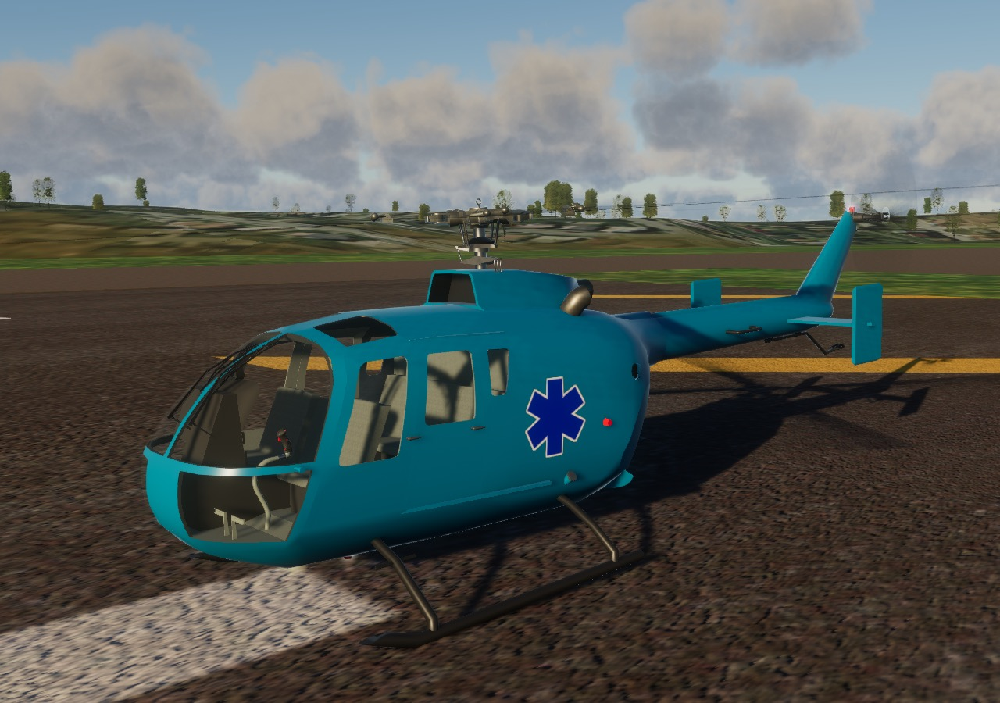

# MBB Bo 105 for FlightGear, with a JSBSim model of its hingeless rotor



The MBB Bo 105 CBS from FlightGear's aircraft collection, with a new JSBSim
flight model in place of its YASim one. The Bo 105's rotor has no flapping or
lead-lag hinges: its blades bend. That gives the quick, crisp response the
aircraft is known for, and a lag mode that couples with the body's roll (air
resonance), which the blades' own damping has to tame. The model is built
around that rotor, from published data, and checked against what the real
aircraft and its rotor are documented to do:

- MBB's flight tests of the prototype and Boeing Vertol's C-81 analysis of
  them (USAAMRDL TR 75-50): trims from hover to 118 kt, and the complete input
  deck, with the blade's mass and stiffness,
- the DLR's research Bo 105 (AGARD AR-280 and the papers around it): trims,
  derivatives and modes identified by six organisations, the roll frequency
  response, verification doublets, and a collective 3-2-1-1 with the rotor
  speed and torque,
- NASA's tests of the full-scale rotor (TM-85892, TM-103867, TM-110356):
  hover performance, blade frequencies and lag damping.

How it was built, and the comparisons test by test, are in the report:
[Bo105-JSBSim-model-report.pdf](Bo105-JSBSim-model-report.pdf).

## What's simulated

- **Main rotor.** The four blades are simulated one by one as elastic beams
  cantilevered from the hub with its 2.5° of precone. Each has its first flap
  and lag bending modes, computed from the blade's mass and stiffness
  distribution (1.11 and 0.67 per revolution), and a quasi-static first torsion
  mode. Eight aerodynamic segments per blade use the NACA 23012 tables of the
  C-81 analysis at their own angle of attack and Mach number, in reverse flow
  too. The hub moments come from the blades' root bending, not from a hinge
  offset, and the rotor speed and the four blades' lag accelerations are solved
  together, since on this soft in-plane rotor the lag modes carry most of the
  blades' inertia about the shaft.
- **Air resonance.** The regressing lag mode and the body's roll couple near
  15 rad/s, where the DLR identified them in flight. The blades have no lag
  dampers; their damping is their aerodynamics plus a structural damping fitted
  to the full-scale rotor's measured decay.
- **Inflow.** A dynamic wake (Peters–He) with ground effect; translational
  lift comes out of it, not out of a special case. A
  ring-vortex wake model carries the rotor's downwash to the fuselage, the
  stabiliser and its end plates, the fin and the tail rotor, for any speed and
  wind direction.
- **Tail rotor** built like the main rotor, as in the UH-60: two blades
  teetering on the hub, on the left of the fin and pushing, each blade's
  pitch coupled to the teeter (δ3 = 45°), six NACA 0012 segments per blade at
  their own angle of attack and Mach number (the C-81 deck's own equations for
  this tail rotor, over ±180°), and an inflow that reverses with the thrust and
  carries on into the vortex ring state. Its blades can stall. Bailey's closed
  form, as in Sikorsky's GenHel, can be built instead for comparison.
- **Fin blockage**, as in the UH-60: the tail rotor's own ring-vortex wake
  gives the air it draws past the fin (or, with the thrust reversed, blows
  onto it), and the fin's lift and drag in that flow push against the
  thrust. On this pusher the fin stands in the slower inflow, not the wake,
  so the effect is small: 1.3 % of the thrust in the hover, 4 % at 30 kt,
  2 % or less in cruise, adding at most 0.2° of tail rotor pitch.
- **Fuselage and empennage** from the C-81 deck's wind tunnel data, with the
  hub's and the skids' drag. The horizontal stabiliser lifts from +4°, as in
  Padfield's data for the DLR's aircraft. The deck's 0° gave too much speed
  stability: the nose rose too hard as the speed built.
- **Engines and rotor speed.** Two Allison 250-C20B engines with their fuel
  controls, start sequence and power turbine governors, fitted to the DLR's
  flight test. The rotor speed is free, so it droops when you pull hard and the
  governors catch it, and you can autorotate.
- **Flight controls** rigged as the C-81 deck has them, with the swashplate's
  control phasing. The basic Bo 105 CBS has no stability augmentation, and
  neither does the model.
- **Cockpit vibration**, as in the UH-60: the 6–30 Hz part of the
  acceleration at the pilot's seat, which the blades' 4-per-rev hub loads put
  there (about 0.01 g at 80 kt, 0.04 g at 120 kt), plus an estimated
  vibration through translational lift (0.05 g at its peak, around 20 kt),
  which the inflow model can't make. It shakes the cockpit view and drives a
  rattle.

All of it is JSBSim XML, generated by a script from the transcribed data;
no Nasal runs the flight model.

## Install

Get the files:

```bash
git clone https://github.com/MrChillStorm/Bo105.git
```

Then add the cloned `Bo105` folder in the FlightGear launcher under Add-ons →
Additional aircraft folders (or start FlightGear with `--fg-aircraft=`
pointing at it), and pick **MBB Bo 105 CBS (JSBSim)**.

- Needs FlightGear 2024.2 or later. The cockpit, lights, liveries and rotor
  are built for the HDR renderer.
- The model runs at 960 Hz: its blades' dynamics and the air resonance need
  it, and at lower rates that mode is under-damped or unstable. In
  FlightGear 2024, which takes a lock for every property read, that costs
  about half of one CPU core; on an older CPU it, not the graphics, can be
  what limits the frame rate.
- The aircraft is in the `MBB_Bo_105` folder with the id `mbb-bo105`, so it
  sits next to the Bo 105 from the hangar without replacing it.
- In multiplayer, other pilots need this aircraft installed to see yours as
  this Bo 105.

## Flying it

- **Start.** On the ground the aircraft starts cold and dark (in the air it
  starts running). The BO-105CBS menu's Autostart, or the `}` key, starts one
  engine after the other and brings them to flight; Autoshutdown, or `{`,
  stops them. `i` toggles the ignition switch.
- **Collective** is the throttle axis: full throttle is the collective at the
  top, closed throttle at the bottom. Reverse your throttle axis if you want it
  the other way.
- **Engines.** `n`/`N` (or the propeller pitch axis) trims the power turbines'
  speed up and down, `m`/`M` (or the mixture axis) balances the load between
  the engines.
- **Rotor brake.** `r` while held, `R` on and off.
- **Landing light.** `L` on and off, or the configuration dialog (`=`). It
  sits under the chin, aimed 30° below the fuselage, so in the hover and on an
  approach it lights the ground ahead (in the HDR renderer). It starts off.
- **Liveries.** The BO-105CBS menu's Select Livery, or `y`/`Y`, picks one of the
  seven variants: Civilian, Blue and Yellow MedEvac, Island Virtual Airways and
  three military ones (MedEvac, anti-tank with HOT missiles, M134 miniguns).
  The paint, the emblem, the blades' tips and the pilots' suits and helmets
  change with it. `=` opens the configuration dialog, where the cockpit
  vibration shake can be turned off.
- **Instrument panel** after the flight manual's instruments, laid out as in
  the Flying Bulls' Bo 105 C on the 3-D model's own console: airspeed,
  attitude, altimeter, HSI and vertical speed in front of the pilot, the
  triple tachometer, dual torque, TOT and N1 gauges, fuel and oil gauges, the
  mast moment indicator, a radio control head and a GPS, and the standby
  compass on the windshield frame. The warning light segments follow the
  flight manual's logic; the TEST FIRE buttons, the LAMP TEST button, the
  mast moment indicator's TEST and the instrument light dimmer work (click
  them).
- **Cockpit lights** (BO-105CBS menu → Cockpit lights), NVG compatible in
  NVIS Green A, as the flight manual's NVG lighting supplement and the UH-60
  have them (in the HDR renderer):
  - the instruments' lighted bezels, on the INSTR LIGHT switch and rheostat
    (the knob on the panel is the same rheostat); the standby compass is lit
    from within;
  - the warning, fire and LIMIT lights, bright, or dimmed for the night with
    their own level; the radio's display follows the daylight, as a photocell
    would;
  - the whip light by the centre console (NVIS green, on and off), the
    utility light at the overhead console (white, OFF–BRT) and the cabin's
    ceiling light (INTERNAL LIGHT).

  A flight started with the sun down has the instrument lights on at half
  and the warning lights dim; by day they start off and bright.
- **Doors.** `d`/`D` selects a door, `Ctrl-D` opens or closes it.

## How it compares

Every number comes from the scripted test programme in the report.

| | Reference | This model |
|---|---|---|
| Level-flight trim, hover to 118 kt | MBB's V-4 (TR 75-50) | collective within 1.0°, cyclic within 1.2° and 0.9°, pitch within 1.2° |
| Level-flight trim, hover to 100 kt | DLR's Bo 105-S123 | collective 0.5–1.1° high, cyclic within 1.4° (0.6° from 60 kt), torque −9 to +2 % |
| Tail rotor pitch in level flight | DLR's Bo 105-S123 | 1.4° low in the hover, 1.4–2.3° high at 20–40 kt, within 0.5° from 60 kt (Bailey's closed form: within 0.4°, 3.0–3.6°, 1.1°) |
| Blade frequencies (flap, lag, torsion) | NASA's analysis tuned to MBB's measurements: 1.12, 0.66, 3.79 per rev | 1.11, 0.67, 3.80 |
| Lag damping in hover at C_T/σ = 0.07 | full-scale rotor (TM-85892): −0.97 1/s | −1.01 1/s |
| Roll response to lateral cyclic at 80 kt, 1–12 rad/s | DLR/AFDD identified transfer function | within 1.1 dB rms, air resonance at the identified frequency |
| Rate responses to four doublets at 80 kt | AGARD AR-280 flight records | on-axis rms error 2.6 deg/s over 10 s |
| Rotor speed after a collective 3-2-1-1 in hover | DLR flight test | rms error 0.17 rad/s (0.37 %) |
| Dutch roll at 80 kt | six identifications: ζ 0.13–0.22, ω 2.17–2.60 rad/s | ζ 0.20, ω 2.75 rad/s |
| Derivatives at 80 kt | six identifications | 17 of 36 within their range |

## Known gaps

- **Rotor in hover.** Against NASA's full-scale hover test the rotor makes
  more thrust per degree of collective (2.6–3.1° less collective for the same
  thrust) and needs 3–11 % less power for the same thrust. The flight trims
  don't confirm it (against the DLR's aircraft the model needs *more*
  collective), and the cause is open; the test ran in a wind tunnel's test
  section, where the rotor's own wake recirculates.
- **Tail rotor pitch.** Between 20 and 40 kt the DLR aircraft's tail rotor
  pitch falls faster than the model's, which is 1.4–2.3° higher there: the fin
  and tail rotor seem to leave the main rotor's wake earlier than the wake
  model has it. In the hover the model needs 1.4° less than the test. The fin
  blockage moves either by 0.2° at most.
- **Cross-couplings.** Several of the 80 kt cross-coupling derivatives (roll
  due to longitudinal cyclic and collective, yaw due to roll rate, pitch due to
  collective) lie outside the spread of the identifications, as they did for
  the C-81 analysis. The pitch and roll damping derivatives are larger than
  any identification's, though the steady rate per unit of cyclic is close to the DLR's.
- **Long term.** In the longitudinal and collective doublets the free model
  drifts away from the aircraft after about ten seconds.
- **Tail rotor at its limits.** Its blades stall and see reversed flow, but no
  published test checks it in strong crosswinds or near its stall, and its
  section comes from C-81's equations rather than measured tables. Its
  shaft's 4° toe is left out.
- **Ground effect** uses the UH-60's hover chart; no Bo 105 one is public.
- **Not modelled:** blade torsion dynamics beyond the quasi-static mode,
  dynamic stall, failures, an electrical system (the panel is always
  powered). The governor's rate limit is not identified.
- **HDR renderer:** it has no particles (FlightGear says so in its log), so the
  rotor's dust doesn't show. In a low sun from ahead, the top row of
  instruments' case tops catch a glint the glareshield should shade.

## Rebuilding the model and the report

The [`fdm`](fdm) folder holds everything that produced the flight model, the
cockpit and the report. It needs Python 3 with `jsbsim` 1.3, `numpy`, `scipy`,
`matplotlib` and Pillow, and [tectonic](https://tectonic-typesetting.github.io)
or another XeLaTeX for the PDF.

```bash
cd fdm
python3 genbo105.py ../MBB_Bo_105 --fg
python3 genbo105.py root/aircraft/bo105
python3 genbo105.py root-bailey/aircraft/bo105 --tr bailey
python3 genbo105.py root-nofin/aircraft/bo105 --no-tr-fin
```

- `genbo105.py` writes the flight model: `--fg` into the aircraft folder
  (`bo105.xml` and `Systems/bo105-*.xml`), otherwise test versions with the
  test loadings for the scripts below into `root/` (`--tr bailey`: with
  Bailey's closed-form tail rotor, `--no-tr-fin`: without the fin blockage,
  for the report's comparisons; `--no-inline` keeps every function named,
  where it otherwise writes those only one other reads into it).
  `engines250.py` writes
  the engines and drive, `blademodes.py` computes the blade modes,
  `bo105data.py` holds the data with their sources, and `data/` the
  transcribed tables: the C-81 airfoil and fuselage data (`c81_0012.py`: the
  tail rotor's 0012 from the deck's equations), the digitised flight
  tests, the identified derivatives and the ring-wake tables (`mrwake.py`
  recomputes the main rotor's, `trwake.py` the tail rotor's over the fin).
- `harness.py` drives the model offline. `sweep.py` (level-flight trims),
  `hover_rotor.py`, `lag_damping.py`, `derivatives.py`, `freqresp.py`,
  `doublets.py` and `engine_response.py` compare it with the tests.
- `report/mkresults.py` runs the whole programme (about two and a half
  minutes on 8 cores) into `report/results/`; `report/build.sh` makes every figure, table
  and number of the report from them and builds the PDF.
- `rotorvis.py` builds the rotor models (the blades driven one by one, their
  blur), `hdrmodel.py` the glass, lights and liveries for the HDR renderer,
  and `materials.py` the textures and materials of the cabin, controls,
  pilots and rotor heads. Run `materials.py`, then `rotorvis.py`, then
  `hdrmodel.py`.
- `cockpit/panel_layout.py` measures the instrument panel from the flight
  manual's figure; `cockpit/gauges.py` and `cockpit/avionics.py` build the
  instruments, and `cockpit/panel.py` the face plate and the layout.

The NASA, Army and AGARD reports are not included; the report lists them as
sources.

## Changes to the FlightGear aircraft

Based on the Bo 105 for FlightGear by Melchior Franz (3-D model, Nasal,
configuration) and Maik Justus (YASim flight model). Changed in 2026, all
inside `MBB_Bo_105`:

- **Folder and id.** Renamed from `bo105` to `MBB_Bo_105` and from
  `bo105-set.xml` to `mbb-bo105-set.xml`; the `Aircraft/bo105/` paths inside
  the files point to the new name.
- **Flight model.** The YASim model (kept as `bo105-yasim.xml`) is replaced by
  the generated JSBSim `bo105.xml` and `Systems/bo105-aero.xml`, `-rotor.xml`,
  `-drive.xml`, `-controls.xml` and `-outputs.xml`, run at 960 Hz, and
  `-airframe.xml` (the fuselage, empennage and fin loads), the engines, the
  fuel and the outputs to FlightGear at 240 Hz, with a
  blade-element tail rotor. The fuel tanks' capacities are the type's (570 l
  and 93 l).
- **Nasal.** `Nasal/bo105.nas`: the engines, fuel and rotor speed are the
  JSBSim model's; the Nasal keeps the start sequence, the gauges' side and the
  cockpit. `Nasal/panel.nas` runs the instrument panel's systems (oil and fuel
  pressures and temperatures, warning lights, mast moment indicator) and
  `Nasal/hdr.nas` tells the model when the HDR renderer runs.
- **Cockpit vibration**, after the UH-60's: `Nasal/bo105.nas` shakes the
  cockpit view by the flight model's vibration level (2 cm per g, far more
  than the real motion, so that the panel blurs; `/sim/model/bo105/vibration-view-scale`
  scales it, and the configuration dialog turns it off), and
  `Sounds/sound.xml` plays a rattle with it (`Sounds/rattling_inside.wav`, from
  Emmanuel Baranger's FlightGear UH-60).
- **Instrument panel** (`Models/Panel/`, written by `fdm/cockpit/`): the
  flight manual's instruments drawn new, sharp, with the manual's markings,
  laid out after the Flying Bulls' Bo 105 C on the model's own console under
  its glareshield, with an attitude indicator, HSI, radio control head and
  GPS; a standby compass, its card turning behind a window, in place of the
  old one. The console and glareshield
  are painted black. The instruments have NVIS Green A lighted bezels (spot
  lamps round each dial, after the UH-60's), the warning lights a night
  dimming, and `Dialogs/lights.xml` is the Cockpit lights dialog;
  `Nasal/panel.nas` sets the levels, and `Models/Lights/interior.xml` holds the
  whip, utility and cabin lights.
- **Views.** The cockpit eye point is the seated pilot's eye in this cockpit,
  checked against the flight manual's stations, with a 90° field of view; the
  pilot and the copilot are hidden from their own seats in FlightGear's and
  FGCamera's cockpit views; the 3-D model is aligned to the
  flight model by its fuselage (its own rotor stands 0.24 m further aft than
  the type's three-view; the visual rotor stays on the model's mast).
- **Rotor models** driven blade by blade by the flight model
  (`Models/Rotor/`, `fdm/rotorvis.py`): the hub at the simulated rotor's
  azimuth, each blade with its own flap and lag bending and pitch; at rest
  the blades droop under their weight below the precone, as the beam's static
  solution has them (the flap mode alone held them up). As it speeds
  up each blade fades out and a faint fan behind it fades in (in the HDR
  renderer; `Models/Effects/RotorBlur`), into a disc as dense as the blades'
  time-averaged coverage, its tip paint a faint ring. The tail rotor likewise.
  They replace the original's blade and disc animations.
- **HDR renderer** (FlightGear 2024.2 and later):
  - the liveries change the paint in it too (`pbr` animations in
    `Models/bo105.xml`, each variant's linear colour and gloss in
    `Models/Variants/`), with the blades' tip paint and the pilots' suits and
    helmets; the livery selector keeps all variants listed (FlightGear's list
    widget filtered the list down to the one picked);
  - the cabin, controls, pilots, rotor heads and tail rotor, which the 3-D
    model paints in flat colours, have detail textures and PBR materials
    (`Models/Textures/Detail/`, `fdm/materials.py`), their colours made linear;
  - the glass is tinted and transparent (`Models/Effects/Glass/`), the
    instruments' glass reflects by Fresnel's equations, and the dials' lighting
    emits (`Models/Effects/Lit/`);
  - the exterior lights are spots aimed out through their lenses
    (`Models/Lights/`), with halos; a landing light under the chin is new;
  - one- and two-channel textures, which it shows as red, are stored as RGB;
    the emblem decal is blended by its alpha instead of showing as a black box;
    the old fake shadow is hidden, since it has real ones.
- **Set file.** Description, credits, the flight model and its rate, the
  minimum FlightGear version (2024.2.0), the launcher's HDR compatibility
  flag, and the launcher ratings by the FlightGear wiki's criteria: FDM 5,
  systems 2, cockpit 3, model 4 (the original's were 5, 1, 2, 3), still beta
  overall, since early-production needs at least 3 in each.

Everything else is as its authors made it; they are credited in
[MBB_Bo_105/ReadMe.txt](MBB_Bo_105/ReadMe.txt) and in the files themselves.

## Licence

GNU General Public License, version 2, the same as the original aircraft. See
[LICENSE](LICENSE).
